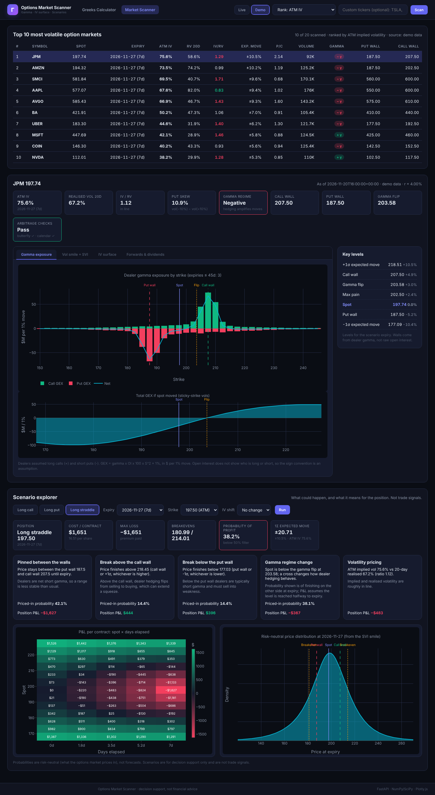
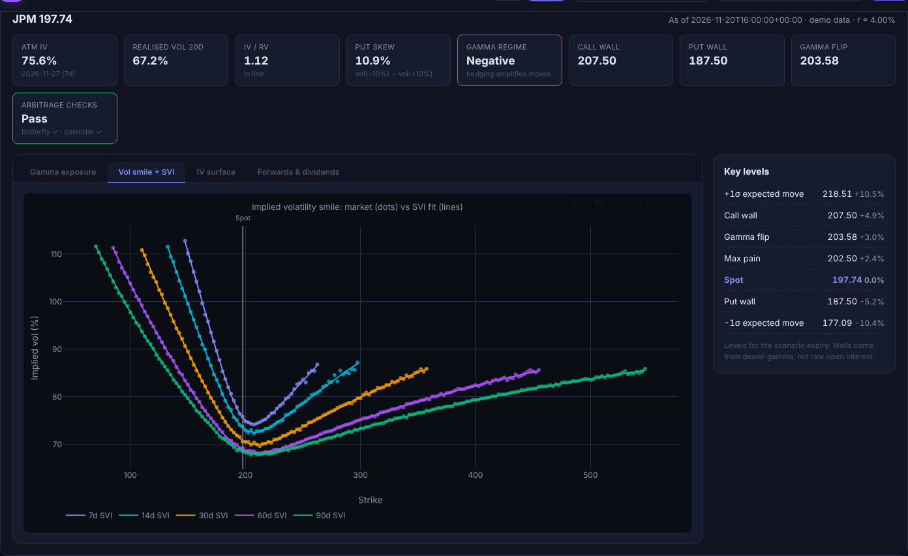

# Black-Scholes Greeks Dashboard + Options Market Scanner

A production-grade options analytics web app in two parts:

1. **Greeks Calculator**: Black-Scholes-Merton pricing and all five Greeks from first principles, with interactive sensitivity charts.
2. **Options Market Scanner** (`frontend/scanner.html`, `backend/analytics/`): scans a universe of optionable stocks each day, ranks the **10 most volatile option markets**, maps **dealer gamma exposure (put walls, call walls, gamma flip)**, builds an **arbitrage-checked SVI implied-volatility surface** with **implied forwards and dividends**, and runs **scenario analysis** for long calls, puts and straddles.

The scanner is built as **decision support, not a signal generator**. It shows what the options market is pricing in and what that would mean for a position, and leaves the decision to the trader.



---

## Options Market Scanner

### Why I built it

I trade index options, and the questions I ask before a trade are always the same. Which names are moving? Where are dealers positioned, and where are the levels that price tends to pin to or break through? Are options cheap or expensive relative to how the stock is actually moving? If I buy this straddle, what has to happen for it to pay, and how likely does the market think that is? This module answers those questions in one screen.

### What it does

| Feature | How it works | Code |
|---|---|---|
| **Daily volatility scanner** | Ranks a 20-name universe (or your own tickers) by ATM IV, IV/RV ratio, expected move or option volume. Symbols are fetched concurrently and failures are isolated. | `analytics/scanner.py` |
| **Implied forward and dividend** | Regresses `C − P` on strike for each expiry. Put-call parity gives slope `−DF` and intercept `DF·F`, so the market's own forward, discount factor, dividend yield and PV of dividends fall out, with no assumed dividend. Robust to stale quotes (MAD outlier rejection). | `analytics/forward.py` |
| **Vectorised IV solver** | Safeguarded Newton with a bisection fallback, solving a whole chain in one NumPy pass. It never diverges, and prices outside no-arbitrage bounds return `NaN` instead of a fake number. | `analytics/bsm.py` |
| **SVI smile and surface** | Fits Gatheral's raw SVI to out-of-the-money IVs per expiry (vega-weighted, multi-start, bounded). Checks **butterfly arbitrage** (Durrleman's `g(k) ≥ 0`) and **calendar arbitrage** (total variance rising with maturity). | `analytics/svi.py`, `analytics/surface.py` |
| **Gamma exposure (GEX)** | `gamma × OI × 100 × S² × 1%` per strike, assuming dealers are long calls and short puts. Finds the **call wall**, **put wall** and the **gamma flip** (where total GEX changes sign as spot moves), and labels the regime: positive gamma dampens moves, negative gamma amplifies them. | `analytics/gex.py` |
| **Scenario engine** | Builds the **risk-neutral price distribution from the SVI smile** (Breeden-Litzenberger), so put skew is reflected. Gives probability of profit, breakevens, max loss, 1σ expected move, max pain, key levels, a P&L grid (spot × days × IV shift) and plain-language scenarios (pinned between walls, break above call wall, break below put wall, gamma regime change, vol rich or cheap). | `analytics/scenarios.py` |
| **Data sources** | `YahooChainSource` (live, delayed) and `SyntheticChainSource` (deterministic chains with a planted SVI smile, dividend yield and OI walls). Synthetic data powers offline demos and gives the tests a ground truth. New vendors plug in by subclassing `ChainSource`. | `analytics/sources.py` |

Scope is deliberately limited to **long call, long put and long straddle**: defined risk, no stock, no naked short options.

### Validation

The tests check that the analytics **recover a known answer**, not just that they run:

- the IV solver round-trips prices to 1e-6 vol and matches the original calculator when `q = 0`
- the forward estimator recovers the planted dividend yield within 0.3% and an exact forward from clean parity
- SVI recovers a known smile to < 0.01 vol pts, and the arbitrage checks flag deliberately bad parameters
- GEX walls land on the planted open-interest strikes, and GEX scales linearly with open interest
- the risk-neutral density integrates to 1 and its mean equals the forward (martingale check), with a fatter left tail under put skew
- long-premium P&L never loses more than the premium paid
- the Yahoo adapter's schema mapping is tested against mocked `yfinance` frames (no network in CI)

```bash
pytest backend/tests -q            # 48 tests (analytics module ~95% covered)
```

| Vol smile vs SVI fit | Forwards, dividends and arbitrage checks |
|---|---|
|  |  |

### Run it

```bash
# from the project root
pip install -r backend/requirements.txt
python -m uvicorn backend.app:app --port 8000      # API
cd frontend && python -m http.server 8080          # UI -> http://localhost:8080/scanner.html
```

Use the **Live / Demo** toggle (or `scanner.html?source=synthetic`) to switch between Yahoo Finance and offline demo data.

| Env var | Default | Meaning |
|---|---|---|
| `CHAIN_SOURCE` | `yahoo` | Default data source (`yahoo` or `synthetic`) |
| `RISK_FREE_RATE` | `0.04` | Continuously compounded rate used for the dividend yield and pricing |
| `ANALYTICS_CACHE_TTL` | `300` | Seconds to cache chains and analyses |

### Analytics API

| Endpoint | Returns |
|---|---|
| `GET /api/analytics/scanner?top=10&sort_by=atm_iv&symbols=&source=` | Ranked top-N table |
| `GET /api/analytics/{symbol}?source=` | Surface (forwards, dividends, SVI fits, arbitrage flags) + GEX profile, walls, flip |
| `GET /api/analytics/{symbol}/scenarios?strategy=long_straddle&expiry=&strike=&iv_shift=` | PoP, breakevens, key levels, P&L grid, density, scenarios |
| `GET /api/analytics/meta` | Sources, universe, sort keys, strategies |

### Honest limitations

- **Risk-neutral probabilities are not forecasts.** They include the market's risk premium (downside protection is usually overpriced), so they show what is priced in, not what will happen.
- **GEX sign is an assumption.** Open interest does not reveal who is long or short. The "dealers long calls, short puts" convention is standard but can be wrong for a given name.
- **Yahoo data is delayed and sometimes stale.** The pipeline filters bad quotes, but a production version would use a paid vendor (OPRA feed, Databento, ORATS).
- **US single-stock options are American.** The forward is fitted on near-the-money strikes, where the early-exercise premium is small, and the smile uses OTM options only. A full treatment would de-Americanise prices first.

---

## Black-Scholes Greeks Calculator

The original calculator: the backend is a FastAPI service that implements the **Black-Scholes-Merton** model from first principles using NumPy/SciPy and exposes a rate-limited REST API; the frontend is a zero-build Plotly.js dashboard that visualises the full Greeks surface across a range of spot prices in real time. Live equity quotes and historical realised volatility are pulled from Yahoo Finance.

The project is deliberately end-to-end: closed-form quantitative model, validated against put-call parity and known analytic bounds, served behind security middleware, packaged in a multi-stage Docker image, and documented for AWS/GCP/Azure deployment.

---

## What this project demonstrates

A compact list of the skills this codebase exercises end-to-end. Each bullet maps to concrete files in the repo.

### Quantitative / Financial Engineering
- **Black-Scholes-Merton pricing for European calls and puts** — closed-form implementation of `d1`, `d2`, `C = S·N(d1) − K·e^{-rT}·N(d2)`, and the put-counterpart (`backend/models/greeks_calculator.py`).
- **All five Greeks from first principles**: Delta, Gamma, Theta (converted to *daily* decay), Vega (per 1% IV move), and Rho (per 1% rate move) — separate analytic formulas for calls and puts where they differ.
- **Numerical correctness verified by financial invariants**: put-call parity (`C − P = S − K·e^{-rT}`), monotonicity of call delta in spot, Gamma peaking at-the-money, sign conventions for Rho (positive calls / negative puts), and call/put delta bounds — see `backend/tests/test_greeks.py`.
- **Historical volatility estimation** from Yahoo Finance closes: log returns, sample stdev, √252 annualisation (`backend/services/market_data.py`).
- **Greeks-surface computation across configurable spot grids** for sensitivity visualisation (`POST /api/greeks-surface`).

### Backend / API Engineering
- **FastAPI** application with Pydantic v2 request/response models, strict field constraints (`gt`, `ge`, `le`), and a custom `field_validator` that gracefully accepts either decimal (`0.25`) or percentage (`25`) inputs (`backend/utils/validation.py`).
- **Per-endpoint rate limiting** via SlowAPI keyed on remote IP — 100/min for calc, 50/min for surface, 30/min for market data.
- **Production middleware stack**: TrustedHost, GZip compression, CORS with environment-aware allow-list, plus a custom security-headers middleware (`X-Frame-Options`, `X-Content-Type-Options`, `Referrer-Policy`, `Permissions-Policy`, `Strict-Transport-Security` in prod).
- **Structured, rotating logs** (10MB × 5) with optional JSON formatter for log shippers; settings loaded from env via `pydantic-settings`.
- **Twelve-factor configuration**: every knob (CORS origins, rate-limit thresholds, log format, environment) is overridable via environment variables.
- **Global exception handler** that hides stack traces in production while preserving full context in `development`.

### Frontend / UX
- **Zero-build vanilla ES6** SPA (HTML + CSS + JS, no bundler, no framework) — fast to clone, fast to load.
- **Plotly.js interactive visualisations**: Greeks sensitivity sliced over spot, full Greeks heat-map across the surface, and option payoff diagrams at expiration.
- **Synchronised inputs**: numeric fields and range sliders are two-way-bound for every parameter.
- **Local-storage calculation history** with one-click parameter restore; dark/light theme; responsive layout.

### DevOps / Production Readiness
- **Multi-stage Dockerfile** (Python 3.11-slim builder + lean runtime), running as a non-root `appuser`, `tini` as PID 1 for clean signal handling, and a baked-in `HEALTHCHECK`.
- **docker-compose** stack with a hardened Nginx reverse proxy for the static frontend (`docker-compose.yml`, `nginx.conf`, `proxy_headers.conf`); separate `docker-compose.prod.yml` for production.
- **Deployment playbooks** for AWS, GCP, and Azure, plus an [operations runbook](docs/operations.md) and a [pre-flight checklist](docs/deployment/checklist.md).
- **Deployment validation scripts** for Linux (`validate-deployment.sh`) and Windows (`validate-deployment.bat`).
- **Pytest suite** covering ATM/ITM/OTM regimes and edge cases on every Greek.

---

## Tech stack

| Layer | Technology |
|---|---|
| Quantitative core | Python 3.11, **NumPy**, **SciPy** (`scipy.stats.norm`) |
| API | **FastAPI**, **Uvicorn** (async ASGI), Pydantic v2, **SlowAPI** rate limiter |
| Market data | **yfinance** (Yahoo Finance), pandas |
| Frontend | Vanilla HTML/CSS/ES6, **Plotly.js** |
| Packaging | Multi-stage **Docker**, **docker-compose**, **Nginx** |
| Testing | **pytest** |

---

## Architecture

```
                +----------------------------+
                |     Browser (Plotly UI)    |
                |   index.html / app.js      |
                +-------------+--------------+
                              | fetch (JSON)
                              v
   +------------------------------------------------------+
   |                  FastAPI / Uvicorn                   |
   |                                                      |
   |  Middleware:                                         |
   |    TrustedHost  -> GZip -> CORS -> SecurityHeaders   |
   |                                                      |
   |  Routes  (rate-limited per IP, slowapi)              |
   |    POST /api/calculate-greeks    (100/min)           |
   |    POST /api/greeks-surface      (50/min)            |
   |    GET  /api/market-data/{sym}   (30/min)            |
   |    GET  /health                                      |
   |                                                      |
   |  Services                                            |
   |    BlackScholesCalculator   (NumPy + SciPy norm)     |
   |    MarketDataService        (yfinance)               |
   +------------------------------------------------------+
                              |
                              v
                  +--------------------------+
                  |  Yahoo Finance (yfinance)|
                  +--------------------------+
```

---

## The math (Black-Scholes-Merton)

Given spot `S`, strike `K`, time-to-expiration `T` in years, risk-free rate `r`, and volatility `σ`:

```
d1 = [ ln(S/K) + (r + σ²/2)·T ] / (σ·√T)
d2 = d1 − σ·√T

C  = S·N(d1) − K·e^{-rT}·N(d2)              (call price)
P  = K·e^{-rT}·N(−d2) − S·N(−d1)            (put price)
```

Greeks (`φ` is the standard-normal PDF, `N` the CDF):

| Greek | Call | Put |
|---|---|---|
| Delta (Δ) | `N(d1)` | `N(d1) − 1` |
| Gamma (Γ) | `φ(d1) / (S·σ·√T)` | same |
| Theta (Θ, per day) | `[−S·φ(d1)·σ/(2√T) − r·K·e^{-rT}·N(d2)] / 365` | `[−S·φ(d1)·σ/(2√T) + r·K·e^{-rT}·N(−d2)] / 365` |
| Vega (ν, per 1% σ) | `S·φ(d1)·√T · 0.01` | same |
| Rho (ρ, per 1% r) | `K·T·e^{-rT}·N(d2) · 0.01` | `−K·T·e^{-rT}·N(−d2) · 0.01` |

Inputs are guarded: `S, K, σ > 0`, `T > 0`, percentage inputs are auto-detected and normalised to decimals.

---

## Quick start

### Prerequisites
- Python 3.11+
- A modern browser

### Run locally (no Docker)

```powershell
# 1. Backend
cd backend
python -m venv .venv
.\.venv\Scripts\Activate.ps1          # Linux/macOS: source .venv/bin/activate
pip install -r requirements.txt
python -m uvicorn app:app --host 127.0.0.1 --port 8000

# 2. Frontend (new terminal, from project root)
cd frontend
python -m http.server 8080
# Open http://localhost:8080
```

### Run with Docker

```bash
docker-compose up --build
# Backend: http://localhost:8000
# Frontend (via Nginx): http://localhost
```

### Run tests

```bash
cd backend
pytest tests/ -v
```

---

## API reference

### `POST /api/calculate-greeks`

```jsonc
// Request
{
  "spot_price": 100.0,
  "strike_price": 100.0,
  "days_to_expiration": 30,
  "interest_rate": 5,          // accepts 5 or 0.05
  "implied_volatility": 25,    // accepts 25 or 0.25
  "option_type": "call"
}

// Response
{
  "call_price": 3.0626,  "put_price": 2.6525,
  "delta_call": 0.5371,  "delta_put": -0.4629,
  "gamma": 0.055421,
  "theta_call": -0.054387, "theta_put": -0.040745,
  "vega": 0.1139,
  "rho_call": 0.0416,    "rho_put": -0.0402
}
```

### `POST /api/greeks-surface`
Returns Greeks vectors across a spot-price grid for heat-map visualisation. Body extends `calculate-greeks` with `spot_range: [low, high]` (as multipliers of spot) and `num_points: int` (5–100).

### `GET /api/market-data/{symbol}`
Live price + 1-year historical realised volatility from Yahoo Finance.

```json
{
  "symbol": "AAPL",
  "current_price": 297.20,
  "historical_volatility": 0.2287,
  "timestamp": "2026-05-19T17:05:57.212973"
}
```

### `GET /health`
Liveness probe returning service metadata.

---

## Project structure

```
BlackScholes-Greeks-Dashboard/
├── backend/
│   ├── app.py                          # FastAPI app, middleware, lifespan, settings
│   ├── Dockerfile                      # Multi-stage, non-root, tini, healthcheck
│   ├── requirements.txt
│   ├── models/greeks_calculator.py     # Black-Scholes + all Greeks
│   ├── routes/api.py                   # Rate-limited endpoints
│   ├── services/market_data.py         # yfinance integration, hist-vol
│   ├── utils/validation.py             # Pydantic request/response models
│   └── tests/test_greeks.py            # 16 unit tests, financial invariants
├── frontend/
│   ├── index.html                      # Sidebar inputs + Plotly canvas
│   ├── app.js                          # State, history, chart wiring
│   ├── api.js                          # Typed fetch client
│   └── styles.css                      # Theme tokens, responsive layout
├── docker-compose.yml                  # Local stack (backend + Nginx)
├── docker-compose.prod.yml             # Production stack
├── nginx.conf, proxy_headers.conf      # Reverse proxy config
└── docs/
    ├── deployment/                     # AWS, GCP, Azure guides + pre-flight checklist
    ├── operations.md                   # Runbook
    ├── requirements.md                 # Functional requirements
    └── quick-reference.md              # Common commands
```

---

## Documentation

| Guide | What it covers |
|---|---|
| [Deployment overview](docs/deployment/README.md) | Choosing a target and deployment steps |
| [AWS](docs/deployment/aws.md) · [GCP](docs/deployment/gcp.md) · [Azure](docs/deployment/azure.md) | Cloud-specific playbooks |
| [Production hardening](docs/deployment/production.md) | Security and production configuration |
| [Pre-flight checklist](docs/deployment/checklist.md) | Checks before going live |
| [Operations runbook](docs/operations.md) | Monitoring, logs, troubleshooting |
| [Requirements](docs/requirements.md) | Functional and non-functional requirements |
| [Quick reference](docs/quick-reference.md) | Common commands |

---

## Testing

The pytest suite verifies the calculator by financial properties rather than just numeric snapshots — this catches a wider class of regressions:

- ATM call/put prices are positive and bounded by spot
- Put-call parity holds within `rtol=1e-4`
- Call delta ∈ [0,1], put delta ∈ [−1,0]
- Call delta is monotonically non-decreasing in spot
- Gamma is strictly positive and peaks at-the-money
- Vega is positive and identical for calls and puts
- Rho is positive for calls, negative for puts
- Invalid inputs (`S ≤ 0`, `T ≤ 0`, `σ ≤ 0`) raise `ValueError`

---

## Known limitations & roadmap

- **European exercise only** — no early-exercise premium. American options would need a numerical scheme (binomial tree or LSM).
- **Zero dividends in the single-option calculator.** The scanner's `analytics/bsm.py` supports a continuous yield `q` and backs it out of the market.
- **Yahoo Finance** is best-effort and rate-limited at source; a production deployment would proxy through a paid market-data vendor with caching.
- **No persistence** for history beyond browser local-storage.

Done: dividend yield `q`, vectorised implied-volatility solver, SVI surface, gamma exposure, scenario engine (see Options Market Scanner).

Planned next steps: de-Americanised prices via a binomial tree, discrete cash dividends, historical IV rank (needs stored daily snapshots), Postgres-backed history.

---

## License

MIT
