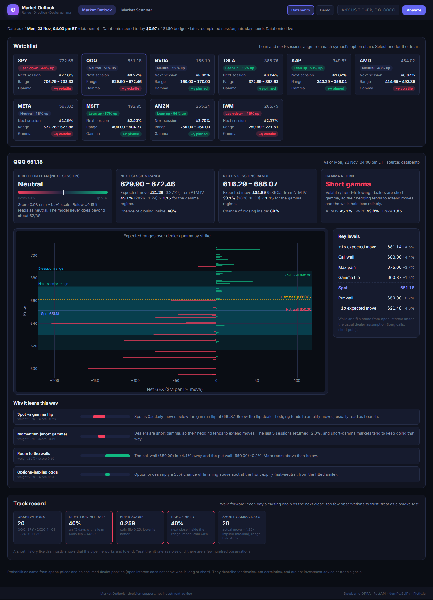
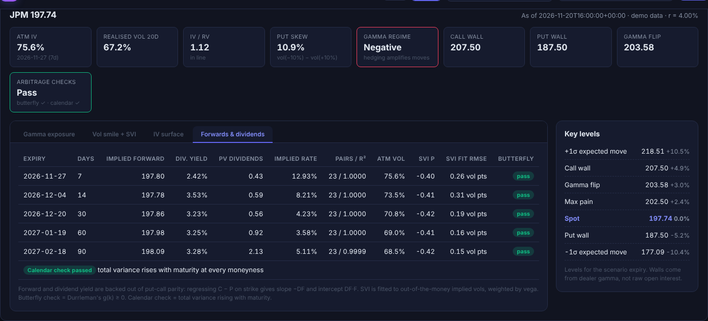

# Options Market Outlook & Scanner

An options analytics web app built on a Black-Scholes-Merton engine written from first principles. It has two pages:

1. **Market Outlook** (main page, `frontend/index.html`): pulls US equity and ETF option chains from **Databento's OPRA feed** and turns dealer gamma exposure and the implied-volatility smile into an **expected range** and a **direction lean** for the next session and the next five, with a **walk-forward track record**.
2. **Options Market Scanner** (`frontend/scanner.html`): ranks the **10 most volatile option markets** of the day, maps **dealer gamma exposure (put walls, call walls, gamma flip)**, builds an **arbitrage-checked SVI volatility surface** with **implied forwards and dividends**, and runs **scenario analysis** for long calls, puts and straddles.

Both are built as **decision support, not signal generators**. They show what the options market is pricing in and what dealer positioning implies, and leave the decision to the user.



---

## Market Outlook

For each symbol on a watchlist the page answers two questions: *how far is it likely to move?* and *which way does positioning lean?*

### How it works

- **Data.** `DatabentoChainSource` pulls one snapshot per symbol from OPRA: contract definitions, the open interest published before the open (only the 10:00–12:00 UTC window, about a quarter of the cost of the full day), the last ten minutes of consolidated quotes, and the underlying's prices from EQUS.MINI. It implements the same `ChainSource` interface as the Yahoo and synthetic sources, so the SVI surface and GEX engine are reused unchanged.
- **Range (the strong part).** The 1σ move comes from the ATM implied volatility of the matching expiry, scaled for the gamma regime: 0.85× when dealers are long gamma (their hedging dampens moves), 1.15× when they are short gamma (it extends them). In a long-gamma regime the call and put walls also cap the range.
- **Direction (the weak part).** Four transparent factors, each scored −1…+1 and explained on the page: spot vs the gamma flip, pull toward the gamma pin (long gamma) or momentum (short gamma), room to the walls, and the options-implied probability of finishing up. The weighted score maps to P(up) with a deliberately small slope, so the model never claims more than about 62/38.
- **Track record.** `backend/scripts/run_outlook_backtest.py` rebuilds the outlook from each past day's closing chain only (no look-ahead) and compares it with the next close: direction hit rate, Brier score against a coin flip, how often the range held, and realised vs implied move by regime. The page shows the result next to every call.

### First backtest (SPY + QQQ, 9–20 Nov 2026, 20 observations)

| Measure | Result | Baseline |
|---|---|---|
| Direction hit rate (15 days with a lean) | 40% | coin flip 50% |
| Brier score | 0.259 | coin flip 0.25 (lower is better) |
| Next close inside the next-session range | 40% | model said 68% |
| Realised / implied move (all short-gamma days) | 1.25× | 1.15× assumed |

Twenty observations is a smoke test, not evidence: it shows the pipeline works end to end. On this sample the direction lean did no better than chance and moves ran larger than implied, so the short-gamma range was too narrow. The parameters were deliberately **not** tuned to these 20 days; that needs a few hundred observations.

### Cost control

Databento bills per download, so every request is priced first with the free `metadata.get_cost` call and refused if it would take the day's spend over `DATABENTO_DAILY_BUDGET_USD` (default $1.50; backtests keep a separate ledger). Every download is cached on disk and never paid for twice, a cross-process file lock stops the API's workers buying the same file at once, and live quotes refresh at most every two hours. The 10-symbol watchlist costs about $1 a day at pay-as-you-go prices.

### Limitations

- **Latest completed session, not real time.** Databento's historical API serves equities up to the previous close and OPRA up to the open, so the page shows the last close plus that morning's open interest. Intraday data needs Databento Live.
- **Direction is a lean, not a forecast.** GEX describes *how much* price tends to move far better than *which way*.
- **The GEX sign is an assumption.** Open interest does not show who is long or short; the "dealers long calls, short puts" convention can be wrong for a given name.
- **Not investment advice.**

---

## Options Market Scanner

### Why I built it

I trade index options, and the questions I ask before a trade are always the same. Which names are moving? Where are dealers positioned, and where are the levels that price tends to pin to or break through? Are options cheap or expensive relative to how the stock is actually moving? If I buy this straddle, what has to happen for it to pay, and how likely does the market think that is? The scanner answers those questions on one screen.


### What it does

| Feature | How it works | Code |
|---|---|---|
| **Daily volatility scanner** | Ranks a 20-name universe (or your own tickers) by ATM IV, IV/RV ratio, expected move or option volume. Symbols are fetched concurrently and failures are isolated. | `analytics/scanner.py` |
| **Implied forward and dividend** | Regresses `C − P` on strike for each expiry. Put-call parity gives slope `−DF` and intercept `DF·F`, so the market's own forward, discount factor, dividend yield and PV of dividends fall out, with no assumed dividend. Robust to stale quotes (MAD outlier rejection). | `analytics/forward.py` |
| **Vectorised IV solver** | Safeguarded Newton with a bisection fallback, solving a whole chain in one NumPy pass. It never diverges, and prices outside no-arbitrage bounds return `NaN` instead of a fake number. | `analytics/bsm.py` |
| **SVI smile and surface** | Fits Gatheral's raw SVI to out-of-the-money IVs per expiry (vega-weighted, multi-start, bounded). Checks **butterfly arbitrage** (Durrleman's `g(k) ≥ 0`) and **calendar arbitrage** (total variance rising with maturity). | `analytics/svi.py`, `analytics/surface.py` |
| **Gamma exposure (GEX)** | `gamma × OI × 100 × S² × 1%` per strike, assuming dealers are long calls and short puts. Finds the **call wall**, **put wall** and **gamma flip** (where total GEX changes sign as spot moves), and labels the regime. | `analytics/gex.py` |
| **Scenario engine** | Builds the **risk-neutral distribution from the SVI smile** (Breeden-Litzenberger), so put skew is reflected. Gives probability of profit, breakevens, max loss, 1σ expected move, max pain, key levels, a P&L grid (spot × days × IV shift) and plain-language scenarios. | `analytics/scenarios.py` |
| **Data sources** | `DatabentoChainSource` (OPRA), `YahooChainSource` (delayed) and `SyntheticChainSource` (deterministic chains with a planted SVI smile, dividend yield and OI walls, for offline demos and test ground truth). New vendors plug in by subclassing `ChainSource`. | `analytics/databento_source.py`, `analytics/sources.py` |

Scope is deliberately limited to **long call, long put and long straddle**: defined risk, no stock, no naked short options.

| Vol smile vs SVI fit | Forwards, dividends and arbitrage checks |
|---|---|
|  |  |

---

## Validation

The tests check that the analytics **recover a known answer**, not just that they run:

- the IV solver round-trips prices to 1e-6 vol and matches the closed-form Black-Scholes engine when `q = 0`
- the forward estimator recovers the planted dividend yield within 0.3% and an exact forward from clean parity
- SVI recovers a known smile to < 0.01 vol points, and the arbitrage checks flag deliberately bad parameters
- GEX walls land on the planted open-interest strikes, and GEX scales linearly with open interest
- the risk-neutral density integrates to 1 and its mean equals the forward (martingale check)
- the Databento adapter maps OPRA definitions, open interest and quotes to the chain schema and recovers the volatility a fake chain was priced at; the spend ledger refuses requests over budget, and a cached request is never paid for twice
- the outlook's probabilities stay inside their bounds, long gamma shrinks and wall-caps the range, and the backtest summary counts hits and coverage correctly
- the Black-Scholes engine satisfies put-call parity, delta bounds and monotonicity, gamma peaking at the money, and the signs of vega and rho

No test touches the network or spends money: Databento and Yahoo are replaced by fakes.

```bash
pytest backend/tests -q            # 61 tests
```

---

## Black-Scholes engine

Both pages sit on a pricing core written from first principles (`backend/analytics/bsm.py`, `backend/models/greeks_calculator.py`). Given spot `S`, strike `K`, time `T` in years, rate `r`, dividend yield `q` and volatility `σ`:

```
d1 = [ ln(S/K) + (r − q + σ²/2)·T ] / (σ·√T)
d2 = d1 − σ·√T

C  = S·e^{-qT}·N(d1) − K·e^{-rT}·N(d2)
P  = K·e^{-rT}·N(−d2) − S·e^{-qT}·N(−d1)
```

| Greek | Call | Put |
|---|---|---|
| Delta (Δ) | `e^{-qT}·N(d1)` | `e^{-qT}·(N(d1) − 1)` |
| Gamma (Γ) | `e^{-qT}·φ(d1) / (S·σ·√T)` | same |
| Vega (ν) | `S·e^{-qT}·φ(d1)·√T` | same |

Gamma drives the GEX profile, vega weights the SVI fit, and the price function feeds the implied-volatility solver and the risk-neutral density. The original closed-form Greeks are still served by `POST /api/calculate-greeks`.

---

## Quick start

### With Docker (recommended)

```bash
# optional: Databento for the Market Outlook (git-ignored)
echo "DATABENTO_API_KEY=db-..." >> .env

docker compose up -d --build
# Market Outlook:  http://localhost
# Market Scanner:  http://localhost/scanner.html
# API:             http://localhost:8000
```

Without a Databento key the outlook falls back to Yahoo and says so. The **Demo** toggle on both pages uses synthetic chains and costs nothing.

### Without Docker

```bash
pip install -r backend/requirements.txt
python -m uvicorn backend.app:app --port 8000      # API
cd frontend && python -m http.server 8080          # UI -> http://localhost:8080
```

### Backtest the outlook

```bash
python -m backend.scripts.run_outlook_backtest --symbols SPY QQQ \
    --start 2026-11-09 --end 2026-11-20 --budget 6
```

Every download is priced and cached, so re-runs are free. Results go to `backend/data/outlook_backtest.json`, which the page reads.

### Configuration

| Env var | Default | Meaning |
|---|---|---|
| `DATABENTO_API_KEY` | (none) | Enables Databento for the Market Outlook |
| `DATABENTO_DAILY_BUDGET_USD` | `1.50` | Cap on live Databento spend per day |
| `OUTLOOK_WATCHLIST` | `SPY,QQQ,NVDA,TSLA,AAPL,AMD,META,MSFT,AMZN,IWM` | Symbols the outlook page loads and the backend prefetches |
| `OUTLOOK_PREFETCH` | `1` | `0` stops the background warm-up of the watchlist |
| `CHAIN_SOURCE` | `yahoo` | Default source for the scanner (`yahoo`, `databento` or `synthetic`) |
| `RISK_FREE_RATE` | `0.04` | Continuously compounded rate used for dividends and pricing |
| `ANALYTICS_CACHE_TTL` | `300` | Seconds to cache chains and analyses in memory |

---

## API

| Endpoint | Returns |
|---|---|
| `GET /api/outlook/{symbol}?source=` | Ranges per horizon, direction lean with factors, key levels, GEX profile, track record |
| `GET /api/outlook/watchlist` | Watchlist symbols, data source, Databento spend today vs budget |
| `GET /api/outlook/backtest` | Backtest summary and every observation |
| `GET /api/analytics/scanner?top=10&sort_by=atm_iv&symbols=&source=` | Ranked top-N table |
| `GET /api/analytics/{symbol}?source=` | Surface (forwards, dividends, SVI fits, arbitrage flags) + GEX profile, walls, flip |
| `GET /api/analytics/{symbol}/scenarios?strategy=long_straddle&expiry=&strike=&iv_shift=` | PoP, breakevens, key levels, P&L grid, density, scenarios |
| `GET /api/analytics/meta` | Sources, universe, sort keys, strategies |
| `POST /api/calculate-greeks` | Closed-form price and Greeks for one option |
| `GET /health` | Liveness probe |

`source` is `databento`, `yahoo` or `synthetic`. The analytics endpoints are rate-limited per IP.

---

## Architecture

```
  Browser ── index.html (Market Outlook) ── scanner.html (Market Scanner) ── Plotly.js
     │
     │ JSON
     ▼
  FastAPI (TrustedHost → GZip → CORS → security headers, SlowAPI rate limits)
     │
     ├── routes/outlook.py ─────► analytics/outlook.py        range + direction lean
     │                            analytics/outlook_backtest.py
     ├── routes/analytics.py ───► analytics/scanner.py, scenarios.py
     │
     │        analytics/service.py   in-memory TTL cache, single-flight per symbol
     │                 │
     │        surface.py (forwards, IV, SVI) ─► gex.py (walls, flip, regime)
     │                 │
     │        ChainSource ── DatabentoChainSource ─► Databento OPRA + EQUS.MINI
     │                     │      (priced first, budget-capped, cached on disk)
     │                     ├─ YahooChainSource ────► Yahoo Finance
     │                     └─ SyntheticChainSource   (offline, ground truth)
     │
     └── Nginx serves the static frontend and proxies /api
```

---

## Tech stack

| Layer | Technology |
|---|---|
| Quant core | Python 3.11, **NumPy**, **SciPy**, pandas |
| Market data | **Databento** (OPRA, EQUS.MINI), yfinance, Parquet cache (pyarrow) |
| API | **FastAPI**, Uvicorn, Pydantic v2, SlowAPI |
| Frontend | Vanilla HTML/CSS/ES6, **Plotly.js** |
| Packaging | Multi-stage **Docker** (non-root, tini, healthcheck), docker-compose, **Nginx** |
| Testing | **pytest** |

---

## Project structure

```
BlackScholes-Greeks-Dashboard/
├── backend/
│   ├── app.py                          # FastAPI app, middleware, settings, prefetch
│   ├── Dockerfile
│   ├── analytics/
│   │   ├── databento_source.py         # OPRA chains: budget ledger, disk cache, file lock
│   │   ├── sources.py                  # ChainSource, Yahoo and synthetic sources
│   │   ├── forward.py, bsm.py          # implied forwards/dividends, vectorised BSM + IV
│   │   ├── svi.py, surface.py          # SVI fits, arbitrage checks, surface
│   │   ├── gex.py                      # gamma exposure, walls, flip
│   │   ├── scenarios.py, scanner.py    # scenario engine, volatility scanner
│   │   ├── outlook.py                  # range + direction lean
│   │   ├── outlook_backtest.py         # walk-forward evaluation
│   │   └── service.py                  # caching service layer
│   ├── routes/                         # outlook.py, analytics.py, api.py
│   ├── scripts/run_outlook_backtest.py
│   ├── data/outlook_backtest.json      # latest backtest results
│   ├── models/greeks_calculator.py     # closed-form Black-Scholes Greeks
│   └── tests/                          # 61 tests, no network
├── frontend/
│   ├── index.html, outlook.js, outlook.css    # Market Outlook
│   ├── scanner.html, scanner.js, scanner.css  # Market Scanner
│   ├── api.js                                 # fetch client
│   └── styles.css                             # theme tokens
├── docker-compose.yml, docker-compose.prod.yml
├── nginx.conf, proxy_headers.conf
└── docs/                               # deployment guides, runbook, screenshots
```

---

## Documentation

| Guide | What it covers |
|---|---|
| [Deployment overview](docs/deployment/README.md) | Choosing a target and deployment steps |
| [AWS](docs/deployment/aws.md) · [GCP](docs/deployment/gcp.md) · [Azure](docs/deployment/azure.md) | Cloud-specific playbooks |
| [Production hardening](docs/deployment/production.md) | Security and production configuration |
| [Pre-flight checklist](docs/deployment/checklist.md) | Checks before going live |
| [Operations runbook](docs/operations.md) | Monitoring, logs, troubleshooting |

---

## Roadmap

- A longer backtest (a few hundred observations across regimes) before tuning the range multipliers or direction weights.
- Intraday snapshots through Databento Live.
- De-Americanised prices via a binomial tree, and discrete cash dividends.
- Historical IV rank from stored daily snapshots.

---

## License

MIT
